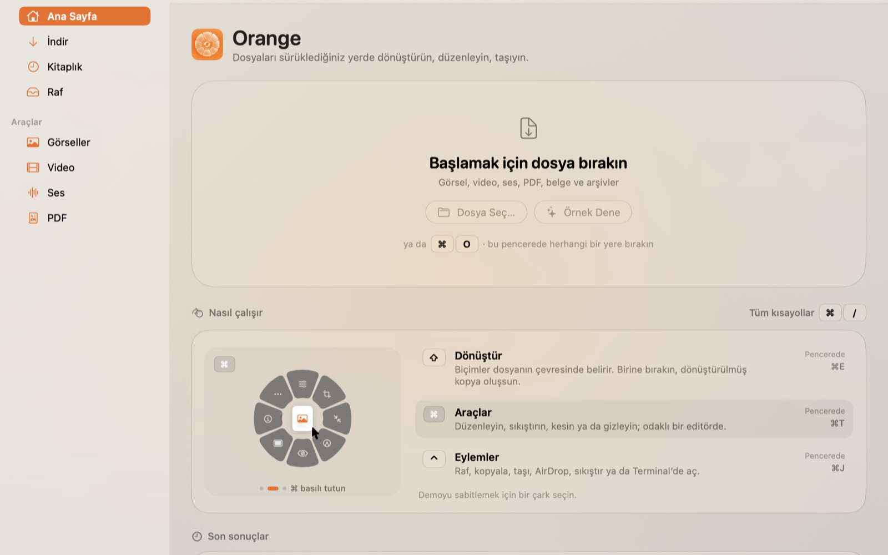
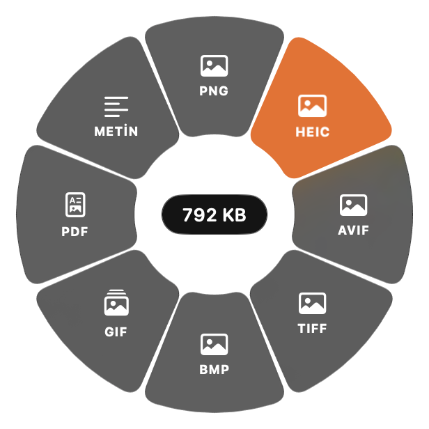
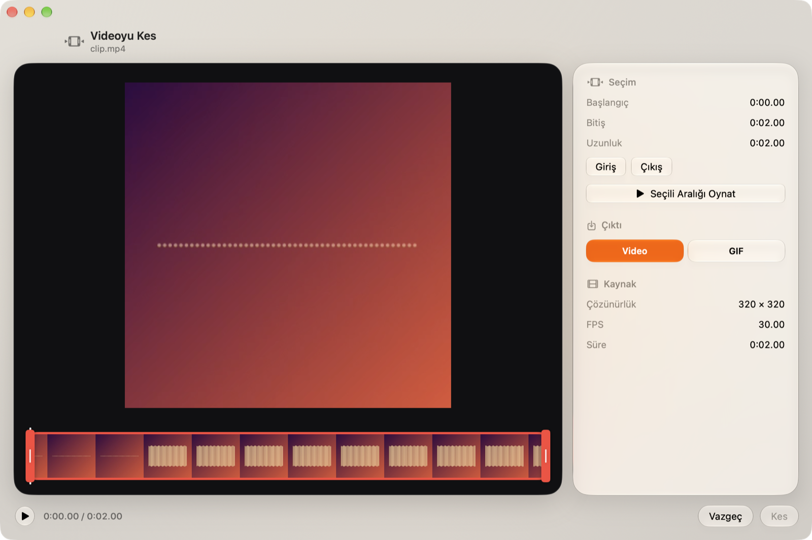
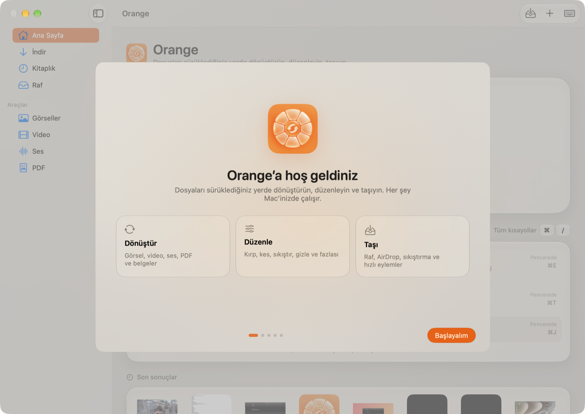

<div align="center">


# Orange

**Dosyaları sürüklediğiniz yerde dönüştürün, düzenleyin, taşıyın.**

Mac için yerel, hızlı ve gizliliğe saygılı bir dosya stüdyosu.

[](https://github.com/MachineX41/Orange-App/releases/latest)
[](https://github.com/MachineX41/Orange-App/releases)


[](PRIVACY.md)

### [⬇︎ Orange’ı İndir (.dmg)](https://github.com/MachineX41/Orange-App/releases/latest/download/Orange.dmg)

[ZIP olarak indir](https://github.com/MachineX41/Orange-App/releases/latest/download/Orange.zip) · [Tüm sürümler](https://github.com/MachineX41/Orange-App/releases) · [SHA‑256](https://github.com/MachineX41/Orange-App/releases/latest/download/SHA256SUMS.txt)

<br>



</div>

---

## İçindekiler

- [Neden Orange?](#neden-orange)
- [Sürükleme çarkı](#sürükleme-çarkı)
- [Özellikler](#özellikler)
- [Kurulum](#kurulum)
- [Gizlilik ve izinler](#gizlilik-ve-izinler)
- [Klavye kısayolları](#klavye-kısayolları)
- [Kaynaktan derleme](#kaynaktan-derleme)
- [Sürüm yayımlama](#sürüm-yayımlama)
- [Proje yapısı](#proje-yapısı)
- [English](#english)

## Neden Orange?

- **Her şey Mac’inizde.** Dosyalarınız hiçbir sunucuya yüklenmez; hesap, reklam veya takip yoktur.
- **Bir hareketle iş biter.** Dosyayı sürüklerken bir tuşa basın, açılan çarkta bir dilime bırakın.
- **Orijinale dokunmaz.** Her sonuç yeni bir kopya olarak orijinalin yanına kaydedilir.
- **macOS’a ait hissettirir.** Liquid Glass arayüz, açık ve koyu tema, tam klavye desteği, Türkçe ve İngilizce.

## Sürükleme çarkı



Finder’dan, masaüstünden veya herhangi bir uygulamadan bir dosyayı sürüklemeye başlayın ve bir tuşa basın. Çark imlecin olduğu yerde açılır ve siz bırakana kadar sabit kalır.

| Tuş | Çark | Ne yapar |
| --- | --- | --- |
| `⇧` Shift | **Dönüştür** | Biçim değiştirir (HEIC → JPG, MOV → MP4, DOCX → PDF…) |
| `⌘` Command | **Araçlar** | Kırp, sıkıştır, kes, gizle; odaklı bir editörde açar |
| `⌃` Control | **Eylemler** | Raf, kopyala, taşı, AirDrop, sıkıştır, Terminal’de aç |

Sürüklerken tuşu değiştirirseniz çark yerinde kalır, yalnızca içeriği değişir. Boş bir yere bırakırsanız işlem iptal olur. Çark, **Erişilebilirlik izni gerektirmez.**

<br clear="right">

## Özellikler



**Dönüştürme**

| Tür | Biçimler |
| --- | --- |
| Görsel | JPG, PNG, HEIC, WEBP, AVIF, TIFF, BMP, GIF, PDF |
| Belge | PDF, TXT, DOCX, RTF, HTML, ODT; Markdown girişi |
| Video | MP4, MOV, M4V, GIF |
| Ses | M4A, WAV, AIFF; videodan ses çıkarma |

**Araçlar**

- **Görsel:** fotoğraf düzenleme (ışık, renk, detay), kırp ve döndür, döndür ve aynala, boyutlandırma, sıkıştırma, işaretleme, yüz ve metin algılamalı gizleme, arka plan ekleme ve kaldırma, kolaj, görsellerden PDF
- **PDF:** birleştirme, bölme, sayfa düzenleme (sürükle bırak, döndürme, silme), sıkıştırma
- **Video:** kesme (video veya GIF), kırpma, hız, sesi kaldırma, kare çıkarma, bölme, bölge gizleme, birleştirme, sıkıştırma
- **Ses:** kesme (sessiz uçları otomatik kırpma), seviye ve normalleştirme, mono/stereo, bip ile sansür, sesten görselleştiricili video
- **Diğer:** meta veri görüntüleme ve temizleme, QR ve barkod okuma, arşiv açma, bağlantıdan indirme

**Uygulama**

- Arka planda çalışan işler ve canlı ilerleme göstergesi
- İşlenen dosyaların kitaplığı ve dosya rafı, yüzen raf penceresi (`⇧⌘L`)
- Menü çubuğu simgesi, girişte açılma (isteğe bağlı)
- İlk açılışta tanıtım ve izin rehberi

## Kurulum

1. **[Orange.dmg](https://github.com/MachineX41/Orange-App/releases/latest/download/Orange.dmg)** dosyasını indirin ve açın.
2. **Orange**’ı **Applications** klasörüne sürükleyin.
3. Orange’ı açın. İlk açılıştaki tanıtım, izinleri tek tek ve nedenleriyle birlikte size sorar.

> [!IMPORTANT]
> **İlk açılışta “Apple doğrulayamadı” uyarısı**
>
> Orange henüz Apple tarafından noter onaylı (notarized) değildir; bu yüzden macOS ilk açılışta uyarı gösterir. Uygulamayı açmak için:
>
> 1. Uyarıda **Bitti**’ye tıklayın.
> 2. **Sistem Ayarları › Gizlilik ve Güvenlik**’e gidin, aşağı kaydırın ve Orange için **Yine de Aç**’a tıklayın.
> 3. Parolanızla onaylayın. Bu işlem yalnızca bir kez gerekir.
>
> Terminal tercih ederseniz: `xattr -dr com.apple.quarantine /Applications/Orange.app`
>
> İndirdiğiniz dosyanın doğruluğunu sürüm sayfasındaki `SHA256SUMS.txt` ile kontrol edebilirsiniz: `shasum -a 256 Orange.dmg`

**Gereksinimler:** macOS 26 Tahoe veya üzeri, Apple silicon (M serisi) Mac.

**İsteğe bağlı, video sitelerinden indirme:** YouTube, Instagram, X ve benzeri sitelerden indirmek için ücretsiz ve açık kaynak [yt‑dlp](https://github.com/yt-dlp/yt-dlp) gerekir:

```bash
brew install yt-dlp
```

Doğrudan dosya bağlantıları yt‑dlp olmadan da indirilir.

## Gizlilik ve izinler



Orange; analiz, telemetri, reklam ve hesap içermez. Ağa yalnızca **İndir** ekranına sizin yapıştırdığınız bağlantı için çıkar.

| İzin | Neden | Zorunlu mu? |
| --- | --- | --- |
| Masaüstü, Belgeler, İndirilenler | Sonucu orijinal dosyanın yanına kaydetmek | Hayır, reddedilirse başka klasör seçilebilir |
| Çıkarılabilir ve ağ birimleri | Bu birimlerdeki dosyalarla çalışmak | Yalnızca kullanıldığında |
| Girişte aç | Çarkın her zaman hazır olması | Hayır, varsayılan kapalı |

Orange **Erişilebilirlik, Ekran Kaydı, Giriş İzleme, Kamera, Mikrofon, Kişiler ve Konum** izni istemez. İzinleri **Ayarlar › Gizlilik** bölümünden görebilir, yerel geçmişi tek tıkla silebilirsiniz.

Ayrıntılar: [Gizlilik Bildirimi](PRIVACY.md) · [Kullanım Koşulları](TERMS.md)

## Klavye kısayolları

| Kısayol | İşlem |
| --- | --- |
| `⌘O` | Dosya aç |
| `⌘1` – `⌘4` | Ana Sayfa, İndir, Kitaplık, Raf |
| `⌘5` – `⌘8` | Görseller, Video, Ses, PDF araçları |
| `⌘E` · `⌘T` · `⌘J` | Seçim için Dönüştür, Araçlar, Eylemler çarkı |
| `⇧⌘L` | Yüzen raf |
| `⌘/` | Tüm kısayollar |

Editörlerde: `Space` oynat/duraklat, `I`/`O` başlangıç ve bitiş, `S` böl, `M` önce/sonra, `↩` uygula, `esc` vazgeç.

## Kaynaktan derleme

Gereksinimler: macOS 26+, Xcode 26+ (Swift 6.2+).

```bash
git clone https://github.com/MachineX41/Orange-App.git
cd Orange-App
swift test                     # motor testleri
./scripts/build-app.sh         # build/Orange.app (release)
open build/Orange.app
```

Geliştirme derlemesi için `./scripts/build-app.sh --debug` kullanın.

## Sürüm yayımlama

```bash
./scripts/package.sh           # build/dist/Orange.dmg, Orange.zip, SHA256SUMS.txt
```

`v*` etiketi gönderildiğinde [Release iş akışı](.github/workflows/release.yml) testleri çalıştırır, uygulamayı paketler ve dosyaları GitHub Releases’a yükler. README’deki indirme bağlantıları her zaman en son sürümü gösterir.

```bash
git tag v0.2.0 && git push origin v0.2.0
```

## Proje yapısı

```
Sources/
  OrangeKit/         Arayüzden bağımsız motor (test edilir)
    Model/           Katalog ve dönüştürme yönlendirici
    Image/ PDF/ Document/ Media/ Vision/ Metadata/ Download/ IO/
  Orange/            SwiftUI uygulaması
    App/             Yaşam döngüsü, çalışma zamanı, modeller
    Design/          Tema, metinler, ortak bileşenler
    Features/        Onboarding, Wheel, Editors, Home, Library, Tools, Download, Settings, Shell
    Services/        İzinler, kitaplık, sürükleme izleyici
Tests/OrangeKitTests
Configuration/       Info.plist, yerelleştirilmiş izin metinleri, simge
scripts/             build-app.sh, package.sh
```

## English

**Orange** is a native, privacy-first file studio for macOS 26+. Start dragging any file and hold `⇧` (Convert), `⌘` (Tools) or `⌃` (Actions): a Liquid Glass wheel opens under the pointer, and dropping on a slice writes a new copy next to the original. Everything runs on your Mac with no accounts, analytics or uploads.

[**Download Orange.dmg**](https://github.com/MachineX41/Orange-App/releases/latest/download/Orange.dmg) (Apple silicon). Builds are not notarized yet; on first launch, open **System Settings › Privacy & Security** and click **Open Anyway**. Optional: `brew install yt-dlp` for downloading from video sites. See the [Privacy Notice](PRIVACY.md) and [Terms of Use](TERMS.md).

---

<sub>Orange bağımsız bir projedir; Tangerine, LEAP STUDIO, Nashi veya Apple ile bağlantılı değildir. macOS ve Liquid Glass, Apple Inc.’in ticari markalarıdır. İndirdiğiniz içeriklerin telif ve kullanım haklarına uymak kullanıcının sorumluluğundadır.</sub>
